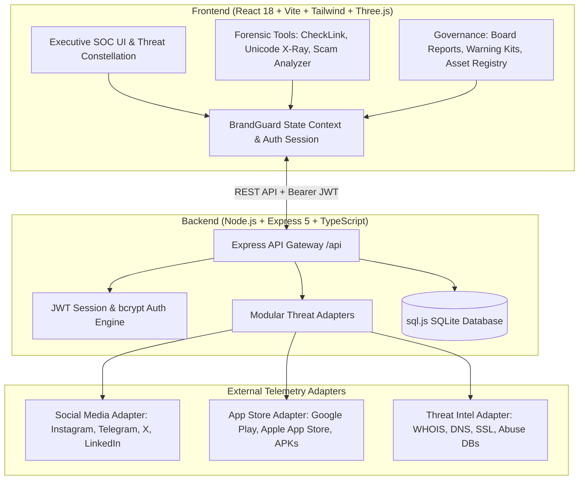

# 🛡️ AEGIS — Enterprise Digital Risk Protection & Brand Intelligence Platform

[](https://www.typescriptlang.org/)
[](https://react.dev/)
[](https://vitejs.dev/)
[](https://expressjs.com/)
[](https://tailwindcss.com/)
[](https://threejs.org/)
[](https://sql.js.org/)
[](LICENSE)

> **AEGIS** (BrandGuard) is a military-grade, full-stack **Digital Risk Protection (DRP) & Brand Defense Platform**. It autonomously surveils the internet, social media networks, mobile app ecosystems, and domain registries to detect brand impersonation, fraudulent lookalikes, rogue mobile APKs, phishing campaigns, and executive spoofing with explainable forensic intelligence.

---

## 📑 Table of Contents

- [Executive Summary](#-executive-summary)
- [System Architecture](#-system-architecture)
- [Core Features & Modules](#-core-features--modules)
  - [1. Security Operations Center (SOC) Overview](#1-security-operations-center-soc-overview)
  - [2. Threat Constellation & 3D Telemetry](#2-threat-constellation--3d-telemetry)
  - [3. Threat Findings & Triage Matrix](#3-threat-findings--triage-matrix)
  - [4. 5-Stage Progressive Disclosure Takedown Workflow](#4-5-stage-progressive-disclosure-takedown-workflow)
  - [5. CheckLink Real-Time URL Inspector](#5-checklink-real-time-url-inspector)
  - [6. Unicode X-Ray (Homoglyph & Punycode Inspector)](#6-unicode-x-ray-homoglyph--punycode-inspector)
  - [7. Scam Script & Lure Analyzer](#7-scam-script--lure-analyzer)
  - [8. Customer Warning Kit Generator](#8-customer-warning-kit-generator)
  - [9. Executive Board Risk & ROI Reports](#9-executive-board-risk--roi-reports)
  - [10. Brand Asset Inventory & DNS Verification](#10-brand-asset-inventory--dns-verification)
  - [11. Target Watchlist Engine](#11-target-watchlist-engine)
  - [12. Ask AEGIS — SecOps AI Copilot](#12-ask-aegis--secops-ai-copilot)
- [Technology Stack](#-technology-stack)
- [Project Structure](#-project-structure)
- [Quick Start & Installation](#-quick-start--installation)
- [Pre-Configured Demo Credentials](#-pre-configured-demo-credentials)
- [REST API Reference](#-rest-api-reference)
- [Environment Configuration](#-environment-configuration)
- [Production Deployment](#-production-deployment)
- [Contributing & License](#-contributing--license)

---

## 🎯 Executive Summary

Modern cybercrime has shifted from perimeter breaches to external brand impersonation, deceptive typosquats, cloned mobile apps, and synthetic social lures that victimize customers and tarnish enterprise reputations.

**AEGIS** bridges the gap between external brand attack surfaces and security analysts by providing:

1. **Explainable AI & Forensic Evidence**: Every flagged threat contains clear heuristic signals (e.g., logo likeness, SSL mismatch, domain age, typosquat distance) rather than black-box alerts.
2. **Actionable Remediation**: Built-in 5-stage takedown workflows generate platform-compliant legal notices (DMCA, registrar abuse, Google/Apple store reporting, Telegram abuse).
3. **Multi-Tenant Brand Defense**: Effortlessly switch between monitored corporate profiles (e.g., AcmePay, Nike, Trek Bikes) or onboard new enterprises on the fly.
4. **C-Suite Translation**: Automatically quantifies avoided financial loss, consumer risk exposure, and generates board-ready slide briefings.

---

## 🏛️ System Architecture



---

## ⚡ Core Features & Modules

### 1. Security Operations Center (SOC) Overview

- **Active Threat Matrix**: Real-time counter of Critical, High, Medium, and Low severity brand incidents.
- **Threat Velocity & Risk Heatmap**: Dynamic charts calculating risk scores based on reach, intent, and visual mimicry.
- **Live Activity Feed**: Continuous log of detected typosquats, rogue profiles, and status transitions.

### 2. Threat Constellation & 3D Telemetry

- Interactive WebGL/Three.js particle canvas visualizing active attack vectors orbiting corporate digital assets.
- Visual node clustering highlighting attack vectors across Web, Mobile, Social, and Infrastructure nodes.

### 3. Threat Findings & Triage Matrix

- **Comprehensive Finding Cards**: Displays avatar initials, platform icon, candidate URL, risk score (0–100), confidence percentage, and publication timeline.
- **Multi-Vector Surveillance**:
  - 📱 **Mobile Apps**: Unofficial APK packages, trojanized banking apps, rogue clones on APKPure/Aptoide.
  - 💬 **Social Media**: Verified-lookalike Instagram handles, scam Telegram channels, customer support impostors on X.
  - 🌐 **Web & Domains**: Typosquats, IDN homoglyphs, combo-squats, and cloned login portals.
- **Triage Actions**: One-click status management (`New`, `Investigating`, `Takedown Requested`, `Resolved`, `False Positive`).

### 4. 5-Stage Progressive Disclosure Takedown Workflow

When clicking **"Initiate Takedown"**, a guided 5-step modal assists the SecOps team:

1. **Target Verification**: Validates candidate URL and official asset collision.
2. **Forensic Evidence Dossier**: SHA-256 evidence package, DNS TXT logs, screenshots, and WHOIS registration stamps.
3. **Abuse Channel Routing**: Identifies appropriate abuse desks (registrar abuse email, Cloudflare abuse, Telegram Anti-Scam, Apple/Google App Review).
4. **Custom Legal Letter Drafting**: Automatically formats pre-filled DMCA notices, trademark infringement notices, and ICANN UDRP filings.
5. **Incident Export & Dispatch**: Copy-ready incident payload or instant webhook dispatch to Jira/ServiceNow.

### 5. CheckLink Real-Time URL Inspector

- Instantly evaluates any suspicious hyperlink or domain.
- Computes Levenshtein edit distance, punycode conversion, SSL expiration status, and heuristic threat ratings.
- Provides immediate safety verdict (`SAFE`, `SUSPICIOUS`, or `CRITICAL_PHISHING`).

### 6. Unicode X-Ray (Homoglyph & Punycode Inspector)

- Forensic tool revealing character substitution attacks.
- Detects Cyrillic (`а`, `о`, `е`), Greek, or Latin lookalikes that appear identical to standard ASCII letters in browsers.
- Decodes ASCII Punycode (e.g., `xn--...`) with zero-width space detection.

### 7. Scam Script & Lure Analyzer

- Natural Language & pattern matching tool to parse SMS texts, phishing emails, and social media direct messages.
- Flags urgency triggers ("Account suspended in 24 hours"), high-risk keywords ("Wire transfer", "One-Time-Passcode"), and spoofed support URLs.

### 8. Customer Warning Kit Generator

- Instant creation of co-branded customer advisories when large-scale phishing waves target an enterprise.
- Generates:
  - Official Social Media Warning Copy (Instagram/X/LinkedIn).
  - Help Center security bulletin text.
  - Recommended customer safeguard steps.

### 9. Executive Board Risk & ROI Reports

- Translates technical indicators into executive business impact.
- Features:
  - **Avoided Fraud Calculation**: Calculates saved capital based on intercepted transactions and brand goodwill metrics.
  - **TTR (Time-To-Resolve) Trends**: Tracks team response velocity.
  - **Print/PDF Ready Export**: Clean presentation layout tailored for C-level briefings.

### 10. Brand Asset Inventory & DNS Verification

- Centralized registry of all verified brand properties:
  - Corporate Web Domains
  - Official Mobile App Packages (Android / iOS)
  - Verified Social Media Handles
  - Registered Trademarks & Key Slogans
- Includes automated DNS TXT record token verification to validate asset ownership.

### 11. Target Watchlist Engine

- High-priority surveillance radar tracking suspect domains, known rogue developers, and recurring threat actor infrastructure.
- Automated alert triggers when dormant typosquats configure MX records or deploy live web servers.

### 12. Ask AEGIS — SecOps AI Copilot

- Context-aware intelligence assistant directly embedded in the dashboard.
- Enables analysts to query finding details, generate tailored remediation strategies, and evaluate threat severity on demand.

---

## 💻 Technology Stack

| Domain                 | Technology           | Purpose                                                 |
| :--------------------- | :------------------- | :------------------------------------------------------ |
| **Frontend Framework** | React 18.3           | Reactive Single Page Application                        |
| **Build & Dev Tool**   | Vite 6.1             | Hyper-fast HMR and optimized production bundling        |
| **Language**           | TypeScript 5.7       | End-to-end type safety                                  |
| **Styling**            | Tailwind CSS 3.4     | Custom cyber/SecOps dark aesthetic, glassmorphism       |
| **3D Graphics**        | Three.js 0.186       | Interactive Threat Constellation particle visualization |
| **Iconography**        | Lucide React         | Modern, consistent security UI iconography              |
| **Backend Runtime**    | Node.js (>=18) + TSX | Fast TypeScript execution with live file watching       |
| **Web Server**         | Express 5.3          | Modular RESTful API and static asset delivery           |
| **Database**           | SQLite (`sql.js`)    | In-memory + disk-persisted relational database          |
| **Authentication**     | JWT + bcryptjs       | Secure stateless tokens with salted password hashing    |
| **Orchestration**      | Concurrently 9.2     | Unified parallel execution of backend & frontend        |

---

## 📁 Project Structure

```
Risk/
├── backend/
│   ├── adapters.ts             # Threat intelligence & social media adapter interfaces
│   ├── auth.ts                 # JWT middleware and token issuance
│   ├── db.ts                   # SQLite database initialization, schemas & seed routines
│   ├── fixtures.ts             # Tailored threat findings & demo data for brands
│   ├── index.ts                # Express application entry, diagnostic dashboard & routes
│   ├── risk.env                # Environment configuration for backend credentials
│   ├── tsconfig.json           # Backend TypeScript configuration
│   ├── data/
│   │   └── brandguard.sqlite   # Persisted SQLite database storage
│   └── routes/
│       ├── assetRoutes.ts      # Brand asset management & DNS verification
│       ├── authRoutes.ts       # Registration, login, session validation
│       ├── companyRoutes.ts    # Multi-tenant company switcher & metadata
│       ├── dashboardRoutes.ts  # Metric summaries and risk matrix calculations
│       ├── findingRoutes.ts    # Threat finding lifecycle, status changes, notes
│       ├── linkCheckRoutes.ts  # Real-time URL inspection & lookalike analyzer
│       └── scanRoutes.ts       # Simulated & live telemetry scans
├── frontend/
│   ├── index.html              # HTML5 entry with cyber theme & Google Fonts
│   ├── package.json            # Frontend workspace dependencies
│   ├── tailwind.config.js      # Custom theme colors, glows, animations, typography
│   ├── vite.config.ts          # Vite build config & proxy to backend:3001
│   └── src/
│       ├── App.tsx             # Main view router & global modal orchestration
│       ├── main.tsx            # React DOM mounting
│       ├── index.css           # Custom scrollbars, cyber grid patterns, glows
│       ├── components/
│       │   ├── assistant/      # Ask AEGIS Copilot modal
│       │   ├── brand/          # Brand asset cards and DNS verification modals
│       │   ├── charts/         # Threat velocity & distribution charts
│       │   ├── common/         # Spotlight cards, animated modals, badges, toast stack
│       │   ├── findings/       # Finding lists, drawer details, takedown modal
│       │   ├── landing/        # Interactive 3D threat constellation & intro animation
│       │   ├── layout/         # Sidebar navigation, topbar with company switch
│       │   ├── overview/       # SOC stat cards, risk matrices, activity log
│       │   └── scan/           # Scan progression modal & result breakdowns
│       ├── context/
│       │   └── BrandGuardContext.tsx  # Centralized React state store & API sync
│       ├── data/
│       │   └── mockData.ts     # Offline fallback datasets & source feeds
│       ├── pages/
│       │   ├── AlertPreviewPage.tsx       # SIEM/Slack alert notification previewer
│       │   ├── AppMonitoringPage.tsx      # Rogue mobile app surveillance feed
│       │   ├── BoardReportPage.tsx        # C-Suite risk report generator
│       │   ├── BrandProfilePage.tsx       # Official asset inventory & verification
│       │   ├── CheckLinkPage.tsx          # Real-time link forensic scanner
│       │   ├── CustomerWarningKitPage.tsx # Customer security advisory builder
│       │   ├── FindingsPage.tsx           # Comprehensive threat findings matrix
│       │   ├── ForgotPasswordPage.tsx     # Self-service credential recovery
│       │   ├── LandingPage.tsx            # Public showcase with interactive 3D demo
│       │   ├── LoginPage.tsx              # Secure login with 1-click demo analyst
│       │   ├── OnboardingWizardPage.tsx   # 4-stage guided company onboarding
│       │   ├── OverviewPage.tsx           # Executive SOC dashboard
│       │   ├── ScamScriptAnalyzerPage.tsx # NLP phishing script analyzer
│       │   ├── SettingsPage.tsx           # API keys, scan cadence & notification rules
│       │   ├── SocialMonitoringPage.tsx   # Social media impersonation tracker
│       │   ├── UnicodeXRayPage.tsx        # Homoglyph & punycode inspector
│       │   └── WatchlistPage.tsx          # Target monitoring & suspicious domain radar
│       ├── services/
│       │   └── api.ts          # Axios-like typed fetch client with auth token interceptor
│       └── types/
│           └── index.ts        # Comprehensive TypeScript definitions for all domain models
├── package.json                # Root package script runner (dev, build, start)
├── tsconfig.json               # Root TypeScript configuration
└── vite.config.ts              # Root Vite configuration with reverse proxy
```

---

## 🚀 Quick Start & Installation

### Prerequisites

- **Node.js**: `v18.0.0` or higher
- **npm**: `v9.0.0` or higher

### 1. Clone & Install

```bash
git clone https://github.com/your-org/brandguard.git
cd brandguard

# Install dependencies for root, backend, and frontend
npm install
```

### 2. Launch Development Environment

Run both the Express backend and the Vite frontend simultaneously with a single command:

```bash
npm run dev
```

This starts:

- 🌐 **Frontend**: [`http://localhost:5173`](http://localhost:5173)
- ⚙️ **Backend API**: [`http://localhost:3001/api`](http://localhost:3001/api)
- 📊 **Server Diagnostic Hub**: [`http://localhost:3001/server-status`](http://localhost:3001/server-status)

### 3. Alternative Individual Run Commands

If you prefer running the client and server in separate terminals:

```bash
# Terminal 1: Backend API (auto-reloads on file change)
npm run server

# Terminal 2: Frontend Dev Server
npm run client
```

---

## 🔑 Pre-Configured Demo Credentials

The platform comes pre-seeded with enterprise accounts and simulated brand attack surfaces:

| Monitored Company        | Lead Analyst Email        | Password      | Industry               |
| :----------------------- | :------------------------ | :------------ | :--------------------- |
| **AcmePay Technologies** | `alex.mercer@acmepay.com` | `password123` | FinTech & Payments     |
| **Nike Global**          | _(Selectable via Topbar)_ | —             | Athleisure & Footwear  |
| **Trek Bikes**           | _(Selectable via Topbar)_ | —             | Manufacturing & Retail |

> **Pro Tip**: On the [Login Page](http://localhost:5173), you can click the quick demo pill to instantly fill the verified SecOps Lead credentials. You can also register any brand from scratch using the **Onboarding Wizard**.

---

## 📡 REST API Reference

The backend provides a RESTful API with JSON responses and standardized HTTP status codes:

### Authentication (`/api/auth`)

| Method | Endpoint                    | Description                                       | Auth Required |
| :----- | :-------------------------- | :------------------------------------------------ | :------------ |
| `POST` | `/api/auth/login`           | Authenticate analyst with email & password        | No            |
| `POST` | `/api/auth/register`        | Register a new enterprise & seed dynamic findings | No            |
| `GET`  | `/api/auth/me`              | Fetch currently authenticated user session        | Yes (JWT)     |
| `POST` | `/api/auth/forgot-password` | Reset password workflow                           | No            |

### Company Management (`/api/company`)

| Method | Endpoint              | Description                                 | Auth Required |
| :----- | :-------------------- | :------------------------------------------ | :------------ |
| `GET`  | `/api/company/list`   | List all available monitored organizations  | Optional      |
| `GET`  | `/api/company`        | Fetch company profile, assets, and metadata | Yes (JWT)     |
| `POST` | `/api/company/switch` | Switch active enterprise context            | Yes (JWT)     |
| `POST` | `/api/company`        | Create/update enterprise profile            | Yes (JWT)     |

### Threat Findings (`/api/findings`)

| Method  | Endpoint                   | Description                                         | Auth Required |
| :------ | :------------------------- | :-------------------------------------------------- | :------------ |
| `GET`   | `/api/findings`            | Retrieve all findings with severity & type filters  | Yes (JWT)     |
| `GET`   | `/api/findings/:id`        | Fetch detailed finding dossier with evidence chain  | Yes (JWT)     |
| `PATCH` | `/api/findings/:id/status` | Update finding status (`Investigating`, `Resolved`) | Yes (JWT)     |
| `POST`  | `/api/findings/:id/notes`  | Append SecOps analyst case notes                    | Yes (JWT)     |
| `GET`   | `/api/social/findings`     | Filter specifically for social impersonations       | Yes (JWT)     |
| `GET`   | `/api/apps/findings`       | Filter specifically for rogue mobile applications   | Yes (JWT)     |

### Forensic Tools & Scans (`/api/link-checks` & `/api/scans`)

| Method | Endpoint                      | Description                                 | Auth Required |
| :----- | :---------------------------- | :------------------------------------------ | :------------ |
| `POST` | `/api/link-checks`            | Perform real-time forensic URL analysis     | Yes (JWT)     |
| `GET`  | `/api/link-checks`            | Retrieve history of checked links           | Yes (JWT)     |
| `POST` | `/api/scans/social`           | Trigger an on-demand social threat scan     | Yes (JWT)     |
| `GET`  | `/api/scans/instagram/status` | Check live Instagram Graph API connectivity | Yes (JWT)     |

### Metrics & Diagnostics

| Method | Endpoint                  | Description                                      | Auth Required |
| :----- | :------------------------ | :----------------------------------------------- | :------------ |
| `GET`  | `/api/dashboard/summary`  | SOC summary counters (Total, Critical, Resolved) | Yes (JWT)     |
| `GET`  | `/api/dashboard/severity` | Threat distribution breakdown                    | Yes (JWT)     |
| `GET`  | `/api/health`             | Service uptime, engine status, database health   | No            |
| `GET`  | `/server-status`          | Interactive HTML SecOps server control center    | No            |

---

## ⚙️ Environment Configuration

Environment variables can be placed in `.env` in the root directory or in `backend/risk.env`:

```env
# Backend Server Port (Defaults to 3001)
PORT=3001

# JWT Secret for session tokens
JWT_SECRET=aegis_super_secret_jwt_key_secops_2026

# Optional: Live Instagram Graph API Integration Token
# When omitted, AEGIS uses realistic simulated threat telemetry.
INSTAGRAM_ACCESS_TOKEN=
```

---

## 🏗️ Production Deployment

### 1. Build the Application

```bash
npm run build
```

This compiles the TypeScript code and outputs the optimized production build to `frontend/dist`.

### 2. Run the Production Server

```bash
npm start
```

In production mode, the Express backend serves both the API endpoints (`/api/*`) and the static production React application directly from `frontend/dist` on port `3001`.

---

## 🔒 Security Best Practices Implemented

- **Password Security**: Passwords hashed with `bcryptjs` using a minimum salt work factor of 10.
- **Session Tokens**: Cryptographically signed JSON Web Tokens (JWT) with authorization middleware on all sensitive endpoints.
- **Scoped Multi-Tenancy**: Data isolation by `company_id` prevents cross-tenant access.
- **Safe Token Exposure**: Diagnostic endpoints never return external secret keys or raw hashes to clients.
- **Defensive Input Parsing**: Robust regex sanitization for homoglyph and IDN punycode parsing.

---

## 📄 License

This project is licensed under the **MIT License**. See the [LICENSE](LICENSE) file for details.

---

<p align="center">
  <b>AEGIS SecOps Core</b> • Defending enterprise integrity and customer trust across the global threat landscape.
</p>
